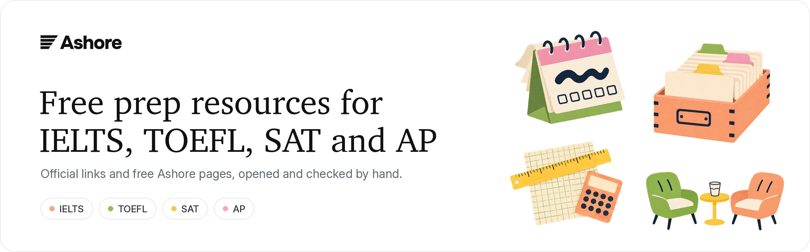
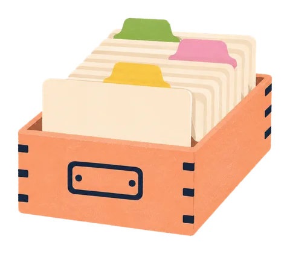
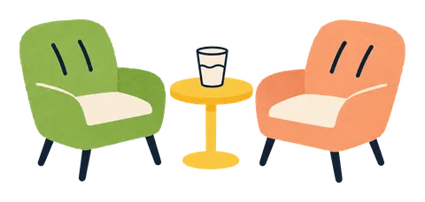
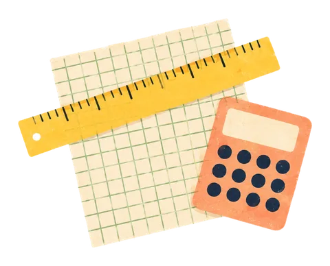
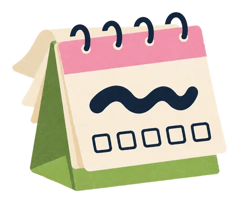
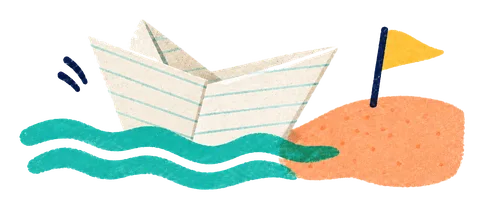

  

  <a href="#ielts">IELTS</a> &nbsp;·&nbsp;
  <a href="#toefl">TOEFL</a> &nbsp;·&nbsp;
  <a href="#sat">SAT</a> &nbsp;·&nbsp;
  <a href="#ap">AP</a> &nbsp;·&nbsp;
  <a href="#college-planning">College planning</a> &nbsp;·&nbsp;
  <a href="#contributing">Contributing</a>

A short, checked list of free prep resources for IELTS, TOEFL, SAT and AP. Every link can be used without paying, and the last column says whether you need an account.

Official sources come first. After them are free pages from [Ashore](https://tryashore.com), an AI test-prep site run by the people who keep this list. We list our own pages next to the official ones, not in place of them.

Last checked: November 2026

 

##  IELTS

**Official**

| Resource | What you get | Account |
| :-- | :-- | :-- |
| [IELTS preparation resources](https://ielts.org/take-a-test/preparation-resources) | Free practice materials and guides from the test owners | No |
| [Speak & Improve](https://speakandimprove.com/) | Free speaking practice with automatic feedback, from Cambridge | — |

**Free from Ashore**

| Resource | What you get | Account |
| :-- | :-- | :-- |
| [Speaking questions, Sep–Dec 2026](https://tryashore.com/ielts/speaking/questions/2026-september-december) | All 85 Part 2 cue cards this season (40 new), 55 Part 1 topics with 258 questions, and 9 stories that cover every card | No |
| [Speaking questions, Jan–Apr 2027](https://tryashore.com/ielts/speaking/questions/2027-january-april) | Not out yet: when new questions usually appear, what carries over, what to practise now | No |
| [Band calculator](https://tryashore.com/ielts/band-calculator) | Overall band from four section scores with the official rounding rule, plus Listening and Reading raw score tables | No |
| [Speaking mock test](https://tryashore.com/ielts/speaking-mock-test) | Parts 1–3 out loud, about 14 minutes, with an AI examiner that asks follow-up questions | First test and report free |

 

##  TOEFL

**Official**

| Resource | What you get | Account |
| :-- | :-- | :-- |
| [TOEFL iBT preparation](https://www.ets.org/toefl/test-takers/ibt/prepare.html) | Free prep materials from ETS | — |
| [TOEFL iBT practice tests](https://www.ets.org/toefl/test-takers/ibt/prepare/practice-tests.html) | Official practice tests from ETS | — |

**Free from Ashore**

| Resource | What you get | Account |
| :-- | :-- | :-- |
| [Interview questions 2026](https://tryashore.com/toefl/speaking/interview-questions) | 100 questions in 25 topics, each with two sample answers at about band 4 and 5.5 | No |
| [Listen and Repeat guide](https://tryashore.com/toefl/speaking/listen-and-repeat) | 7 sentences that get longer, each scored 0–5, and where most answers lose points | No |
| [Speaking scoring](https://tryashore.com/toefl/speaking/scoring) | 11 questions at 0–5, turned into a 1–6 band in half steps | No |
| [Score converter](https://tryashore.com/toefl/score-converter) | New 1–6 scale to the old 0–120 total or 0–30 section scores, with ETS's tables and CEFR levels | No |
| [Speaking mock test](https://tryashore.com/toefl/speaking-mock-test) | Listen and Repeat plus 4 interview questions in about 8 minutes, with an AI-estimated 1–6 band | First test free |

 

##  SAT

**Official**

| Resource | What you get | Account |
| :-- | :-- | :-- |
| [Bluebook](https://bluebook.collegeboard.org/) | The College Board app for the digital SAT, with full-length practice tests | Free College Board account |
| [SAT practice tests](https://satsuite.collegeboard.org/practice/practice-tests) | Full-length practice tests and answer explanations | — |
| [SAT dates and deadlines](https://satsuite.collegeboard.org/sat/dates-deadlines) | Test dates, registration deadlines and score release dates | No |
| [Khan Academy Digital SAT](https://www.khanacademy.org/digital-sat) | Free official SAT practice, made with College Board | Free, to save progress |

**Free from Ashore**

| Resource | What you get | Account |
| :-- | :-- | :-- |
| [SAT hub](https://tryashore.com/sat) | 2026–27 test dates, registration deadlines and score release days | No |
| [Two-week study plan](https://tryashore.com/sat/two-week-study-plan) | Day by day from November 21 to the December 5, 2026 SAT: two Bluebook practice tests, how to review them, pacing per module | No |
| [November 2026 scores](https://tryashore.com/sat/november-2026-scores) | November 7 scores come out November 20: where to find them, what to read first, December deadlines | No |

 

##  AP

**Official**

| Resource | What you get | Account |
| :-- | :-- | :-- |
| [AP exam dates](https://apstudents.collegeboard.org/exam-dates) | The official exam schedule | No |
| [AP course index](https://apstudents.collegeboard.org/course-index-page) | Course descriptions, exam formats and past free-response questions | No |
| [AP score distributions](https://apstudents.collegeboard.org/about-ap-scores/score-distributions) | Share of students earning each score | No |

**Free from Ashore:** 15 course pages. Each gives the 2027 exam date and time, the exam format, the share of students who scored a 5 in 2026, and a short lesson for every topic. No account.

| Math and science | History and social science | English and computer science |
| :-- | :-- | :-- |
| [Calculus BC](https://tryashore.com/ap/calculus-bc) | [US History](https://tryashore.com/ap/us-history) | [English Language](https://tryashore.com/ap/english-language) |
| [Statistics](https://tryashore.com/ap/statistics) | [World History](https://tryashore.com/ap/world-history) | [English Literature](https://tryashore.com/ap/english-literature) |
| [Physics 1](https://tryashore.com/ap/physics-1) | [US Government](https://tryashore.com/ap/us-government) | [Computer Science A](https://tryashore.com/ap/computer-science-a) |
| [Physics C: Mechanics](https://tryashore.com/ap/physics-c-mechanics) | [Microeconomics](https://tryashore.com/ap/microeconomics) | |
| [Physics C: E&M](https://tryashore.com/ap/physics-c-electricity-and-magnetism) | [Macroeconomics](https://tryashore.com/ap/macroeconomics) | |
| [Chemistry](https://tryashore.com/ap/chemistry) | | |
| [Biology](https://tryashore.com/ap/biology) | | |

 

## College planning

| Resource | What you get | Account |
| :-- | :-- | :-- |
| [College chances calculator](https://tryashore.com/chances) | Enter your SAT or ACT and the colleges you're considering. See each college's middle 50%, whether to send your score, and how many points would move a reach to a target | Email to see results |
| [College profiles](https://tryashore.com/colleges) | Middle 50% SAT, median and admit rate for 377 colleges, plus 33 that don't read scores | No |

 

## Notes

- Ashore scores are AI estimates, not official scores from IELTS, ETS or College Board.
- Ashore has paid plans. Every Ashore link in this list is a page you can use for free.
- "—" means we haven't confirmed whether an account is needed.
- IELTS is a registered trademark of the University of Cambridge, the British Council and IDP Education. TOEFL is a registered trademark of ETS. SAT and AP are registered trademarks of College Board. None of them are affiliated with this list or with Ashore.

## Contributing

Found a broken link, or know a free resource that belongs here? Open an issue or a pull request with:

- the link
- one line on what it does
- whether it needs an account
- whether it is fully free or has a free part

We only add resources that are free to use and that we have opened ourselves.

 

   
  Maintained by <a href="https://tryashore.com">Ashore</a> · <a href="LICENSE">CC0 1.0</a>, use this list however you like

